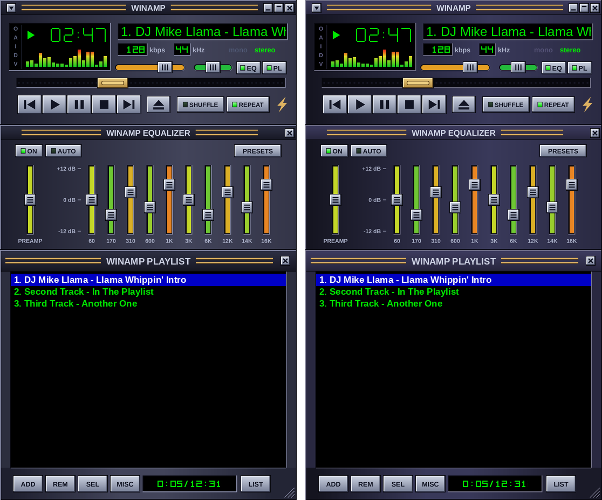

# Winamp Classic HD (2K / 4K)

The Classic Winamp look, redrawn at 1.5×, 2×, 3× and 4× so it stays sharp on 1440p and 4K displays — in the default blue-grey or a violet-grey **Purple** theme.

Classic skins (`.wsz`) are locked to a 275×116 px main window and can only be pixel-doubled. This project rebuilds the same layout as a **Modern (freeform) skin** (`.wal`), with every bitmap rendered natively at the target size.



*Default theme on the left, Purple on the right. The preview is a mock-up composed by the generator, not a screenshot.*

## Downloads

Ready-to-install builds are in [`dist/`](dist/) (skin version 1.24). Each size comes in both themes:

| Size | Default theme | Purple theme | Main window | Suggested for |
|---|---|---|---|---|
| 1.5× | `Classic HD x1.5.wal` | `Classic HD Purple x1.5.wal` | 413×174 | 1440p |
| 2× | `Classic HD x2.wal` | `Classic HD Purple x2.wal` | 550×232 | 1440p (large) or 4K (small) |
| 3× | `Classic HD x3.wal` | `Classic HD Purple x3.wal` | 825×348 | 4K |
| 4× | `Classic HD x4.wal` | `Classic HD Purple x4.wal` | 1100×464 | 4K |

## Install

1. Double-click a `.wal` file and confirm the "install this Winamp Skin?" prompt, **or** copy it into `C:\Program Files (x86)\Winamp\Skins`.
2. Pick it under **Options → Skins**. Both themes and all sizes can be installed side by side.

Developed and tested on **Winamp 5.8 (build 3660)** on Windows 11. It needs the Modern skin engine (`gen_ff.dll`), which ships with Winamp 5.x.

## Themes

- **Default** – blue-grey body and frames.
- **Purple** – the violet-grey of the original Winamp 2.x base skin (body colours sampled from it). Only the chrome changes: window bodies, title bars, frames, bevels and the window / menu background. Buttons, slider handles, LEDs, text and the green displays stay exactly the same as in the default theme.

## What's in the skin

- **Main window** – Classic layout: clock, visualizer, scrolling song title, kbps / kHz, mono / stereo, volume, balance, seek bar, transport, shuffle / repeat, EQ / PL toggles.
- **Windowshade mode** – `WINAMP` label, a small spectrum visualizer, pixel-digit clock and transport buttons.
- **Equalizer** – preamp + 10 bands, ON / AUTO / PRESETS.
- **Playlist** – resizable, ADD / REM / SEL / MISC / LIST, total-time readout, centred title.
- **Library, Video, Visualization** – resizable frames in the same style.

Classic details that were reproduced:

- Clock digits use the original Classic digit shapes (9×13, 1 px strokes), redrawn as vectors.
- kbps / kHz, the playlist time and the windowshade clock share one small pixel-digit font.
- Window bodies and the playlist bottom bar are shaded left-to-right like Classic: dark at the left edge, brighter across the middle, darker again towards the right.
- Volume, balance and EQ bars are a single colour that follows the slider value (green → yellow → orange → red).
- Song title always scrolls with a `***` separator, even when it is short enough to fit.
- Gold seek handle; three grip lines on the volume, balance and EQ handles.

## Known gaps

- No track number (`1.`) in front of the song title.
- No EQ curve graph; the O-A-I-D-V letters are decorative.
- Playlist has no windowshade mode.
- The playlist's track list is drawn by Winamp itself; its font size is set in **Preferences → Playlist**, not by the skin.
- kbps / kHz digits are centred in their boxes rather than right-aligned.
- Video and Visualization windows, and window resizing, have had little testing.

## Build from source

Requirements: Python 3, [Pillow](https://python-pillow.org/), and Liberation Sans (or DejaVu Sans) Bold/Regular installed under `/usr/share/fonts/truetype/`.

```sh
python3 gen.py <scale> <outdir> [default|purple]

# build every size in both themes (fractional scales such as 1.5 work)
for s in 1.5 2 3 4; do
  python3 gen.py $s out
  python3 gen.py $s out purple
done
```

Each run writes the unpacked skin folder (`out/Classic HD x<scale>/` or `out/Classic HD Purple x<scale>/`), the installable `.wal` next to it, and `out/preview_x<scale>.png`. The preview file name does not include the theme, so the second build of the same size overwrites it.

Everything — bitmaps, XML and packaging — is produced by the single script [`gen.py`](gen.py). Coordinates are written in Classic units (275×116) and multiplied by the scale; all colours come from the palette block near the top of the file, which the Purple theme overrides.

## How a few things work

- **Value-coloured bars without scripts.** A hidden second slider bound to the same value carries a huge gradient image as its "thumb". A groove-sized group clips it, so the groove shows one near-uniform colour that changes with the value.
- **Short titles still scroll.** The song ticker gets a large negative right padding, so Winamp treats every title as wider than the box and keeps it moving.
- **Resizable windows need a region.** A layout with no background image has an empty window region; each frame sits in a group with `background` + `sysregion="1"`, otherwise the window exists but is invisible.
- **Bitmap-font text is clipped if the text box is not wider than the text**, so the kbps / kHz / playlist-time boxes are deliberately oversized and positioned by measurement.
- **Fractional scales.** Bitmap fonts are rendered onto an exact whole-pixel cell grid at every scale, so 1.5× digits stay aligned.

## Third-party files

`assets/songinfo.maki` and `assets/titlebar.maki` are compiled scripts taken unmodified from the **Winamp Modern** skin that ships with Winamp 5.8. They drive the kbps / kHz / mono-stereo display and keep window titles centred. They are © their respective owners (Nullsoft / Winamp) and are included only because the skin cannot provide those two behaviours without them. Everything else in this repository was written for this project.

Winamp is a trademark of its respective owner. This is an unofficial fan skin.
